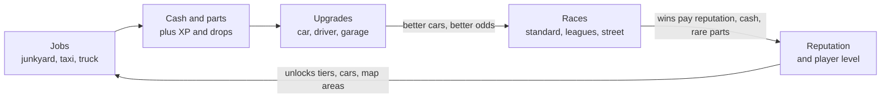

# Apex Racing — Design Doc

## Vision and core loop

A strategic, browser-based car game: players build up a garage, send cars on timed jobs, upgrade cars and driver, and race other players and AI. Races are simulated from stats, skills and choices, not driven. A real-time driving mode is parked for later.

The loop: **jobs earn cash and extras → cash and parts buy upgrades → upgrades win races → races earn cash, reputation and rare parts → reputation unlocks new tiers**. Wear, fuel and the police keep the loop from running unchecked.



Design principles:

- **Decisions over timing.** The advantage comes from choosing which car, which job, which setup, not from reacting at the right second. Runs and upgrades can be queued, so being offline is not a big penalty and bots gain little.
- **One car can't do everything.** Parts have tradeoffs, so owning several specialised cars pays off.
- **Every number lives in config.** Balance changes without code changes (see Balancing).

## Resources

Five resources, each with a clear source and a clear way to spend it.

| Resource        | Role                    | Sources                                       | Spent on                                              |
| --------------- | ----------------------- | --------------------------------------------- | ----------------------------------------------------- |
| Cash            | Main currency           | Jobs, workshop, race prizes                   | Upgrades, cars, repairs, fuel, entry fees, bail       |
| Parts           | Building material       | Junkyard and other job drops, race rewards    | Upgrades, workshop input, market                      |
| Fuel            | Limits activity per day | Slow passive refill, petrol station job, shop | Every job and race                                    |
| Reputation      | Progress gate           | Races, events, leagues                        | Unlocks car classes, tracks, map areas, upgrade tiers |
| Rare components | Endgame                 | Bosses, events, top league places             | High-level upgrades, special cars                     |

Money sinks are planned from day one, or cash piles up and loses value: repairs, fuel, race entry fees, bail, crew salaries and market fees.

## Progression

Five things grow: each car, the driver, the player's level, the garage and the car collection.

**Car upgrades.** Each part improves racing, jobs, or both. Costs follow a curve of about base × level^1.35; higher levels are gated by reputation tier.

| Part             | Racing effect           | Job effect                                 |
| ---------------- | ----------------------- | ------------------------------------------ |
| Engine           | Power, top speed        | Travel speed                               |
| Tires            | Grip, launch            | Terrain penalty                            |
| Suspension       | Handling                | Fragile cargo, comfort for taxi passengers |
| Weight reduction | Acceleration, braking   | —                                          |
| Trunk / trailer  | —                       | Cargo size                                 |
| Winch / loader   | —                       | Loading speed at the junkyard              |
| Fuel tank        | Fuel load in long races | Range per job                              |

**Driver skills.** Earned with XP and skill points; the part of progress that belongs to the player, not the car. Starting set: reaction, shifting, cornering, overtaking, car control, consistency, fuel saving, mechanical sympathy (less wear), evasion (lower bust chance).

**Player level and reputation.** XP raises the level; reputation from racing sets the tier. Tiers unlock car classes, tracks, map areas and upgrade levels.

**Garage.** The base: workshop (passive income), parking (number of cars), storage (parts cap), showroom (sale price), tuning bay (setup options).

**Car collection.** Several cars with different roles: a hauler, a truck, a taxi, a drag car, a drift car. Buying new cars is a major goal.

## Jobs

Every job pays cash plus something extra (parts, XP, bonus cash). The pilot has three: junkyard, taxi and truck driving. Each wants a different kind of car.

**Common job model.** Every job is defined in config by the same fields: duration, fuel cost, the car stats that matter, base pay, an extras drop table, wear per part, police chance, and XP (player and driver skills).

### Junkyard: steady, low risk

- Sites on the map hold a limited amount of scrap and refill over time.
- Trunk size limits the haul; a winch or loader speeds up collecting.
- Extras: random parts by rarity (common, rare, epic). Better sites have better drop tables.
- The safe choice for beginners and for cars not needed elsewhere.

### Taxi: the contested area

Passengers appear on a city map, visible to every nearby player. A car stays where its last fare ended, so position matters: the closer, faster car gets there first.

| Passenger    | Pay            | Wants                          | Twist                         |
| ------------ | -------------- | ------------------------------ | ----------------------------- |
| Student      | Low, small tip | Anything                       | Common, short rides           |
| Business     | High           | A fast car                     | Big tip if quick              |
| Tourist      | Medium         | Comfort                        | Long rides, good total        |
| VIP          | Very high      | A luxury car in good condition | Rare, unlocked by taxi rating |
| Shady client | Huge           | No questions                   | Police chance                 |

- **Collision:** once a car is sent, the passenger shows as "taken, en route", but others can still try. First to arrive gets the fare. The loser gets a small consolation payment, or can choose "steal", which forces a short race for the passenger.
- **Taxi rating:** passengers rate speed, comfort and car condition. A higher rating unlocks better passengers and bigger tips.
- **Surge zones and times of day** (airport in the morning, clubs at night) move players around and create crowded spots.
- **Two ways to play:** manual (pick passengers yourself, best pay) or shift mode (the car takes fares automatically for X hours, lower average pay).

### Truck driving: long and lucrative

- Trips of 4–12 hours with high pay. The truck is locked for that time, which is the real cost.
- Needs a truck, a separate vehicle class.
- Cargo types: regular (safe), fragile (pay depends on suspension and condition), refrigerated (deadline), contraband (very high pay, police risk).
- A truck in poor condition can break down partway, delaying the trip or costing a repair.
- Convoys: club members leaving together get a pay bonus.

### Later jobs

- **Petrol station:** pays partly in cheap fuel. Shift-based, no car needed.
- **Car wash:** cash plus cosmetic items (paint, wax).
- **Mechanic:** repair other players' cars, so damage creates work for someone else.
- **Tow truck:** pick up broken-down cars, including other players' failed truck runs.

### Car time vs driver time

A player has one driver and several cars. The player's own driver is needed for races and taxi. Long jobs (trucking, junkyard runs) can be done by **hired drivers**, crew members on salaries. Growing this "company" is a progression path of its own.

## Racing

Races are simulations: car stats, driver skills, car condition and a bit of randomness produce the result. Three formats share one core algorithm, still to be designed.

### Standard race

No setup needed: press "race" and the outcome comes from what you have built over time. The everyday race, against AI or other players' cars driven by AI. The core race algorithm is defined here first; the other formats adjust it.

### Leagues: drag, sprint, drift

Each category values different things, so each is its own way to upgrade.

|                   | Drag                                | Sprint                       | Drift                                    |
| ----------------- | ----------------------------------- | ---------------------------- | ---------------------------------------- |
| Key car stats     | Power, weight, gearing, launch grip | Top speed, handling, braking | Power, steering angle, rear grip balance |
| Key driver skills | Reaction, shifting                  | Cornering, overtaking        | Car control, style                       |
| Decided by        | Fastest time on a short straight    | Fastest time on a circuit    | Style score, not time                    |

- **Parts with tradeoffs:** drift tires have less grip (good for drift, bad for sprint); drag gearing gives strong acceleration and a low top speed. One car can't win everything.
- Players either swap parts between races (costs time or money) or own a car per category.
- Weekly divisions with promotion and relegation; a reset each season.

### Daily street race

At a random time each day, players get a 10-minute warning. Whoever joins in that window races; the result is calculated for everyone when entries close.

- **Brackets** by level or car class, so new players have a real chance.
- **Illegal:** a high prize and a real bust chance, tied to the police system.
- **Format varies by day** (drag today, sprint tomorrow), so every kind of build gets its day.
- Needs reliable alerts, so in-game and push notifications are required for this format.

## Social

Clubs are the main social system; in games like this they are usually the biggest reason players stay.

**Clubs (crews)**

- 10–30 members with roles (leader, officers, members); join by application or invite.
- **Club level:** members contribute cash, parts or race points; higher levels unlock perks for all members (cheaper repairs, faster jobs, more parking).
- **Club garage:** members lend cars to each other for specific races.
- **Club bank:** donations fund club upgrades and can pay a member's bail.

**Competition between clubs**

- **Club league:** members' race results add up to a weekly club score.
- **Club wars:** two clubs face off over a weekend in a set of races.
- **Territory:** clubs control map areas and take a cut of every job there; other clubs can challenge for an area.

**Between players**

- **Rivalries:** the game tracks repeated races between the same players and offers revenge races with a bonus.
- **Direct challenges** for a stake.
- **Chat:** global, club, and direct messages.

**Limits on moving value between players.** Players will run alt accounts to feed a main account. Every way value moves between players (market, gifts, club bank, lent cars) gets limits: daily caps, fees, a minimum account level.

## Police, jail and damage

Risky jobs and races can land the player in jail or damage the car; both are tuned entirely from config.

### Police and jail

- **Heat** (0–100) rises with illegal activity (street races, shady passengers, contraband) and drops slowly over time.
- **Bust chance** per activity = the activity's base risk × the player's heat × modifiers (evasion skill, a less conspicuous car, club perks).
- **Jail:** the player can't do anything for a while. Get out early by paying bail (a money sink) or having the club bank pay it.
- **Impound:** a lighter penalty; only the car used is locked for a time.

### Damage

- Each part has a condition from 0 to 100%. Performance drops as condition drops.
- Below a threshold there is a failure chance: the part breaks mid-race or mid-job, the player loses, and the repair costs more.
- Repairs cost cash and time. A higher workshop level and a mechanic on the crew make them cheaper and faster.
- An aggressive race strategy wins more often and wears parts faster.

## Engagement

All of these are in scope; most come after the pilot.

- **Missions and achievements:** daily, weekly and long-term goals.
- **Daily rewards and login streaks.**
- **Crew members:** hired drivers, a mechanic (faster, cheaper repairs), a tuner (better setups), a scout (better jobs). Passive bonuses paid with salaries.
- **Cosmetics:** paint, wraps, rims, plates. Pure status, and the cleanest way to monetize if that ever happens.
- **Notifications:** in-game alerts and push notifications for finished jobs, rivals at your site, finished upgrades and the daily street race.

## Balancing

No game number lives in the code: prices, rewards, risks, wear and formula coefficients all come from versioned config data. An illustrative example (the values are placeholders):

```yaml
activities:
  street_race:
    entry_fee: 500
    prize: [3000, 1500, 750]
    heat_gain: 15
    bust_base_chance: 0.08
    wear: { engine: 4, tires: 10, suspension: 3 }
    jail_minutes: [30, 120]

police:
  heat_decay_per_hour: 5
  bail_per_jail_minute: 20

damage:
  performance_at_condition: [[100, 1.0], [50, 0.9], [20, 0.7]]
  failure_below: 25
  failure_chance_per_point_below: 0.01
```

Around the config:

- **Admin page** to change values without deploying code.
- **Versioned configs,** so it is clear which numbers were live when something went wrong, with rollback.
- **Simulator:** a script that plays thousands of simulated players through a few weeks and reports cash earned, time to max level and jail time per day. It catches broken balance before players do.
- **Telemetry** from real players, compared against what the simulator predicted.

## Pilot scope

The pilot is strategic only and covers the full loop: earn, upgrade, race, compete. The rest follows once the economy's behaviour is visible.

| Area        | Pilot                                                                           | Later                                         |
| ----------- | ------------------------------------------------------------------------------- | --------------------------------------------- |
| Jobs        | Junkyard, taxi, truck driving                                                   | Petrol station, car wash, mechanic, tow truck |
| Progression | Car upgrades, 2–3 cars, a few driver skills, level and reputation tiers, garage | Hired drivers and other crew                  |
| Racing      | Standard race, leagues (drag, sprint, drift), daily street race                 | Bosses, server events, seasons                |
| Risk        | Police, jail, bail, wear, repairs, fuel                                         | Impound, police perks                         |
| Social      | Rankings                                                                        | Clubs, club wars, territory, player market    |
| Engagement  | Missions, notifications                                                         | Daily rewards, cosmetics                      |
| Balancing   | Config, admin page, simulator                                                   | Telemetry dashboards                          |

A real-time driving mode (Three.js + Rapier) is out of scope for the pilot.

## Open questions

- [ ] The core race algorithm: how stats, skills, condition and randomness combine into a result.
- [ ] Do clubs exist from the start, or unlock at some level?
- [ ] Territory: in the game, or too much?
- [ ] Trading: free between all players, or only within clubs?
- [ ] Mechanics for the later jobs (petrol station, car wash, mechanic, tow truck).
- [ ] Contents of the job drop tables (which parts, which rarities).
- [ ] Platform: web only, or mobile too?
- [ ] Monetization: none, cosmetics, or a premium currency?
- [x] The game's name: **Apex Racing**.
